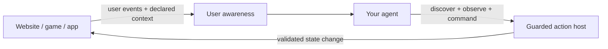

# EIRVIO

**Event-Instrumented Runtime for Verified Interface Operations.**

EIRVIO gives an agent installed in an interface two capabilities:

1. **Act in the interface.** Discover available actions, observe current state, then execute an authorized action and receive its outcome.
2. **Stay aware of the user.** Read current interface context and receive meaningful user interactions as they happen.

A website, game or app supplies its own actions, state projection and event hooks. EIRVIO provides the shared contracts, user-awareness API and guarded execution. The same contracts work with a scripted agent or your own model loop.

**Early release · MIT · JavaScript ESM + TypeScript declarations · No runtime dependencies.** The host requires Node.js 22 or newer; the client, awareness and event stream run in modern browsers. “Verified” means input validation, host authorization and revision checks, not formal verification. The event API uses the familiar `track(name, properties)` pattern; there are no Mixpanel or Amplitude integrations, analytics destinations, cookies or autocapture.

## Try both directions

```sh
git clone https://github.com/Pineapulse/eirvio.git
cd eirvio
npm ci
npm run check
npm start
```

Open [localhost:8810](http://127.0.0.1:8810/). Select a task and watch the agent's user-awareness panel update. Ask the scripted agent to highlight your selection, or complete it. The highlight changes the rendered interface through a guarded host action; it does not replace the user's selection. Reliability controls demonstrate exact retries, stale-state rejection, interruption and lost-reply recovery.

The example uses disposable in-memory state and a deterministic agent. It needs no model credentials. `npm run demo` runs a terminal example.

Install the Git release in another project:

```sh
npm install github:Pineapulse/eirvio#v0.2.0
```

GitHub is the release channel; the package is not published to the npm registry.

## Make the agent aware of user interactions

```js
import {createEventStream, createInterfaceAwareness} from 'eirvio';

const events = createEventStream({
  maxEvents: 200,
  catalog: {
    'ui.task_selected': {
      properties: {taskId: {type: 'string', maxLength: 160}},
      required: ['taskId']
    }
  }
});
const awareness = createInterfaceAwareness({
  events,
  surface: {id: 'task-board', kind: 'website'},
  contextSchema: {
    properties: {selectedTaskId: {type: 'string', maxLength: 160}},
    required: ['selectedTaskId']
  },
  initialContext: {selectedTaskId: ''}
});

// Wire this to the host interface's actual selection handler.
function onUserSelect(taskId) {
  awareness.updateContext({selectedTaskId: taskId});
  events.track('ui.task_selected', {taskId}, {actor: 'user'});
}

const unsubscribe = awareness.subscribe(notification => {
  // Forward to your agent's context queue. This does not execute an action.
  console.log(notification);
});
const current = awareness.snapshot();
// current.context, current.activities, current.nextCursor
```

Context is explicitly declared and schema-checked. Snapshots include current context, user activities, source identity and pagination/gap information. Subscriptions deliver user activities and context changes; agent/system events are filtered out of user activity. Actor labels are descriptive assertions, not credentials or proof of a human action. No DOM, keystrokes or field values are collected automatically.

## Let the agent act in the interface

```js
import {createInteractionClient} from 'eirvio';

const client = createInteractionClient({transport}); // your transport or trusted host
const actions = await client.catalog();
const observation = await client.observe();
const user = awareness.snapshot();

// Your agent chooses a declared action and its parameters.
const command = client.prepare('interface.showTask', {
  taskId: user.context.selectedTaskId
}, {observation, commandId: crypto.randomUUID()});
const outcome = await client.submit(command);
```

The host validates current permissions and the exact runtime, scene, scope and optional view guards. Domain rules execute the action and the interface renders the resulting projected state. The sample exposes `interface.showTask` and `tasks.complete`; your application defines its own operations.

Keep the prepared command when retrying. A stale command is rejected rather than rebased. If delivery is uncertain, look up the original ID or resubmit the exact envelope. Creating a new ID is a new attempt.

Awareness and the host observation are separate samples. Updating awareness does **not** update native view guards. Applications that must invalidate work when the user changes selection or screen must bind those changes into their authoritative runtime view. See the [integration guide](docs/integration.md).

## One contract across interface types

| Interface | What the agent can do through registered actions | What the interface can report |
| --- | --- | --- |
| Website | Open a panel, update an allowed field, highlight an item | Navigation, selection, submitted forms, validation errors |
| Game | Select a unit, highlight a move, start an allowed animation | Selected piece, player move, camera or mode changes |
| App | Navigate a screen, edit an allowed record, confirm a workflow step | Active screen, changed controls, canceled or completed steps |

These are integration patterns. This release does not automatically discover arbitrary UI controls or ship framework-specific DOM, Babylon.js or native-app adapters. A native application needs a JavaScript integration or a bridge to the JSON contracts.



| Entry point | Responsibility |
| --- | --- |
| `eirvio` | Browser-safe awareness, events, client and typed errors |
| `eirvio/host` | Public projections, permitted action discovery and scoped host boundary |
| `eirvio/core` | Commands, scopes, sequences, effects, receipts, in-memory storage and replay |
| `eirvio/contracts/*` | Language-neutral core protocol schemas and examples |

See the [SDK API](docs/sdk.md), [integration guide](docs/integration.md), [task-board domain](examples/task-board/domain.mjs) and [core contract](packages/core/contracts/API.md).

## Release boundaries

- `MemoryStore`, event history and awareness context are in memory. They are suitable for bounded prototypes; production durability and reconnect persistence require application integration.
- Production authentication, authorization policy, rate limits and transport security belong to the integrating application. Client events never grant authority.
- Each host boundary needs a dedicated scope. Commands check optional view freshness; scoped controls check runtime fence, control revision and scope epoch, with view ID as a boundary.
- Outcome lookup is admitted per host instance. After host recreation, resubmit the exact original envelope before lookup. Keep unresolved envelopes until reconciliation.
- Effect dispatch is an at-most-once handoff. A receipt describes rendering or playback; it cannot commit domain state or prove user understanding.
- The SDK runs no LLM, infers no user intent and acts on no event automatically. AG-UI, A2UI, MCP and model-provider adapters are not included.

The core was extracted from a chess tutor with its original tests and protocol. This package imports no chess, graphics, account, billing or model SDK. See [provenance](docs/provenance.md), [security](SECURITY.md) and [contributing](CONTRIBUTING.md).
