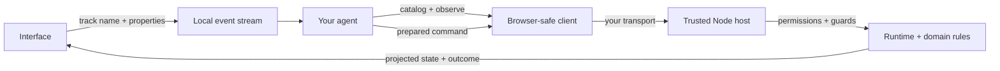

# EIRVIO

**Event-Instrumented Runtime for Verified Interface Operations.**

EIRVIO connects agents to interfaces through meaningful events, discoverable actions and guarded state changes. Instrument your interface with `track(name, properties)`, let an agent inspect the allowed action catalog, then submit a command against an explicit observation. The same interface contract works with a scripted agent, your own model loop, or ordinary UI controls.

“Verified” means validated inputs, host authorization and revision checks. It does not mean formal verification.

**Early release · MIT · JavaScript ESM + TypeScript declarations · No runtime dependencies.** The host requires Node.js 22 or newer; the client and event stream run in modern browsers. The event API borrows the familiar event-name/properties pattern from product analytics, but includes no Mixpanel, Amplitude, tracking service, cookies, autocapture or model provider integration.

## Try the complete example

```sh
git clone https://github.com/Pineapulse/eirvio.git
cd eirvio
npm ci
npm run check
npm start
```

Open [localhost:8810](http://127.0.0.1:8810/). Select a task to publish a UI event, then complete it yourself or run the deterministic demo agent. Expand **Try reliability controls** to see exact-command retries, stale-observation rejection, scope interruption and recovery from a deliberately lost reply. The example has no model credentials and its state resets when the server stops. `npm run demo` runs a terminal version.

To consume the initial Git release in another project:

```sh
npm install github:Pineapulse/eirvio#v0.1.0
```

GitHub is the release channel for 0.1.0; this project has not been published to the npm registry.

## Instrument the interface

```js
import {createEventStream} from 'eirvio';

const events = createEventStream({
  maxEvents: 200,
  catalog: {
    'ui.task_selected': {
      properties: {taskId: {type: 'string', maxLength: 160}},
      required: ['taskId']
    }
  }
});

events.subscribe(event => console.log(event.name, event.properties));
events.track('ui.task_selected', {taskId: 'design'}, {actor: 'user'});
const recent = events.history({after: 0, limit: 20});
```

Only declared events and properties are accepted. Events carry a cursor, timestamp, actor and optional trace/correlation IDs. History is bounded and reports gaps. Subscribers receive detached copies; errors cannot change command outcomes. Events remain observations, and actor labels are descriptive metadata rather than credentials.

## Connect an agent

```js
import {createInteractionClient} from 'eirvio';

// Provide your transport, or pass a trusted in-process host directly.
const client = createInteractionClient({transport});
const actions = await client.catalog();
const observation = await client.observe();

// Let your agent choose from actions using observation.projection and UI events.
const command = client.prepare('tasks.complete', {taskId: 'design'}, {
  observation,
  commandId: crypto.randomUUID()
});
const outcome = await client.submit(command);
```

Keep the prepared command when retrying. Its ID, arguments and observation guards are immutable. A stale command is rejected rather than rebased. If delivery is uncertain, use `client.getOutcome(command.commandId)` or resubmit that exact command. A new ID represents a new attempt, not a retry.

The Node host is created with `createInteractionHost` from `eirvio/host`. It receives a core runtime, a fresh trusted permission resolver, a dedicated scene/scope/view boundary and an action catalog. Domain validators/reducers registered through `eirvio/core` remain the authority for legal state transitions. See the complete [task-board domain](examples/task-board/domain.mjs), [SDK API](docs/sdk.md) and [core contract](packages/core/contracts/API.md).

## How it fits together



| Entry point | Responsibility |
| --- | --- |
| `eirvio` | Browser-safe events, client, preparation helpers and typed transport errors |
| `eirvio/host` | Public projections, permitted action discovery and scoped host boundary |
| `eirvio/core` | Commands, scopes, sequences, effects, receipts, in-memory storage and replay |
| `eirvio/contracts/*` | Language-neutral protocol schemas and examples |

UI frameworks, game engines, agent providers and HTTP/WebSocket transports remain application choices. This release includes an in-process adapter and a local HTTP example. AG-UI, A2UI, MCP and provider-specific adapters are not implemented.

## Boundaries of this release

- `MemoryStore` is not durable storage. Its full-state journal and retained command outcomes are suitable for bounded prototypes, not indefinite production sessions. Supply and validate a durable storage adapter before relying on crash recovery.
- The host narrows trusted permissions on every call. Production authentication, authorization policy, rate limits and transport security belong to the integrating application. Never accept a client-supplied `admin` or permission context.
- Give each host boundary a dedicated scope. Commands check scene, scope, runtime and optional view freshness. Scoped controls check runtime fence, control revision and scope epoch; their view ID is a boundary, not an additional view-revision freshness guard.
- Outcome lookup is admitted per host instance. After recreating a host, resubmit the exact original envelope before looking it up. Losing the envelope cannot safely be solved by inventing a new identity.
- Effect dispatch is an at-most-once handoff. A receipt describes rendering or playback; it cannot commit domain state or prove user understanding. There is no automatic external-effect replay or background dispatcher.
- The SDK does not run an LLM, render a UI, infer DOM meaning or grant permissions from events. The example agent is explicitly scripted.

The foundational core was developed in a chess tutor and extracted here with its original tests and protocol. The standalone example uses a task board; the package imports no chess, graphics, account, billing or model SDK. See [provenance](docs/provenance.md), [security](SECURITY.md) and [contributing](CONTRIBUTING.md).
