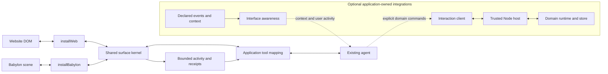
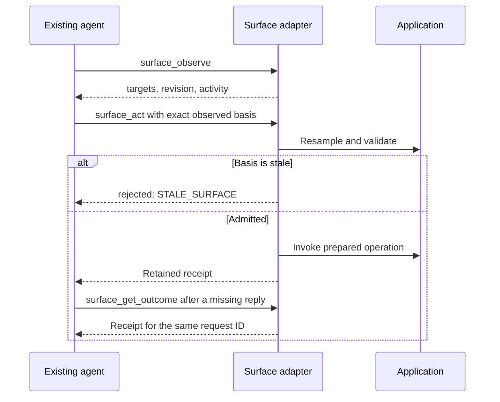

# EIRVIO architecture

EIRVIO gives an existing agent two capabilities: **interact with an interface** and **follow user activity**. It describes supported targets and actions, checks requests before dispatch, and supplies a bounded stream of interaction observations. Your agent still decides what to do and when.

This document describes **v0.3.1**, an MIT JavaScript package with TypeScript declarations. Its automatic adapters run inside your browser application. They require no EIRVIO server, model credentials or analytics service. Install the pinned GitHub release with `npm install github:Pineapulse/eirvio#v0.3.1`; the package is not published to the npm registry.

## Start at the interface

Installation is one call after the page body or scene exists:

```js
import {installWeb} from 'eirvio/web';
const surface = installWeb(); // document.body, or supply {root: element}
```

For an existing Babylon scene, use `installBabylon({scene})` from `eirvio/babylon` instead. Neither installation creates an agent. Connect `surface.tools`, whose entries contain `{name, description, parameters}`, to your agent framework's tool format. Route parsed calls through `surface.callTool(name, arguments_)`.

Both adapters offer `surface_observe`, `surface_act` and `surface_get_outcome`. Your integration owns any remote transport, authentication, scheduling and context queue. The [quickstart](quickstart.md) shows the concrete wiring.

## Components and boundaries



An [overview SVG](./diagrams/eirvio-architecture.svg) and its [editable Mermaid source](./diagrams/eirvio-architecture.mmd) are available for sharing.

Download the [Word explainer](../artifacts/architecture/EIRVIO-architecture-explainer.docx) for an editable document version.

The [web adapter](../packages/sdk/src/web.mjs) samples supported DOM semantics, native form values and control state. Stable references follow element identity, so a replacement button cannot inherit the old button's reference. It advertises supported click, fill, select, check, focus and scroll operations, and dispatches native setters and events for form interactions.

The [Babylon adapter](../packages/sdk/src/babylon.mjs) samples supported meshes and the active camera, observes picking, and offers camera focus and bounding-box highlighting. Mesh references identify objects rather than names. Position samples can change with animation without invalidating every action; semantic state remains guarded. Thin instances are represented as an aggregate. Discovery does not create gameplay rules or arbitrary mesh-method tools.

Both use the internal [surface kernel](../packages/sdk/src/surface.mjs). It owns revision checks, action admission, retained receipts, bounded event history and the common tool descriptors. The public adapters hide its internal recording and lifecycle hooks. These adapters **do not route through the optional domain host or core runtime**.

## From observation to action

An observation contains an `adapterId`, `revision`, targets with opaque references and `actionSchemas`, and recent activity. A request supplies that lifetime ID, a unique request `id`, the observed revision, target reference, advertised action and arguments.

Before a new action, the kernel samples again. A user's intervening edit, a replaced target or a changed capability can reject the plan. The adapter validates arguments and prepares the native operation before effects begin. Exceptions after execution starts produce uncertainty; they cannot safely establish that nothing happened.



Current web and Babylon operations return `dispatched`: invocation occurred, but application success needs separate evidence. A click may be canceled, fail form validation, navigate away or trigger asynchronous work. The shared contract also supports `completed`, which describes an adapter-defined operation, not a successful purchase, save or game objective. DOM and scene actions are not rollback transactions.

## Receipts, retries and lifetimes

Retain the entire request until its outcome is known. Within the same adapter lifetime, an exact retry returns its retained receipt without repeating the effect. Changed content under the same ID rejects. A bounded ledger rejects new requests when full rather than silently dropping old identities.

A missing reply or `uncertain` receipt is a reason to reconcile by ID. A fresh observation and new ID represent a new attempt. `getOutcome()` returning `null` does not prove that application code did nothing.

Receipts and history live in memory. Navigation, reload or reinstall creates a new lifetime and loses the old ledger. Let installation generate a fresh adapter ID; an explicit ID must also be unique per lifetime. Disposal releases listeners and owned resources, without undoing application effects. There is no durable recovery guarantee across process or page loss.

## Activity informs the agent

DOM interactions and Babylon pointer observations enter the adapter's event feed automatically. `subscribe()` supplies live notifications; `observe().activity` includes recent events; `history()` pages through retained history. Continue with `nextCursor`, check `gap` for eviction, and deduplicate overlapping live/history events by `(adapterId, cursor)`.

Events distinguish user, agent and system attribution, but are not authentication or proof of human intent. For example, asynchronous DOM scroll events have uncertain origin. Input activity records contain metadata rather than typed values. Events never invoke agent actions automatically; queue work outside synchronous listeners, where reentrant action calls reject.

For applications with richer semantics, [declared event streams](../packages/sdk/src/events.mjs) and [interface awareness](../packages/sdk/src/awareness.mjs) are optional. Authors declare closed property schemas, publish events such as `task.selected`, and replace current context explicitly. Awareness combines current context with retained **user** activity. Its context revision and lifetime cursor are separate from surface revisions and domain authorization; changing awareness does not itself fence a remote command.

## When the application needs authoritative rules

The optional [interaction client](../packages/sdk/src/client.mjs), [trusted host](../packages/sdk/src/host.mjs) and [core contract](../packages/core/contracts/API.md) serve application-defined operations. The host obtains trusted permissions and confines commands to configured scene, scope and view boundaries. The core applies registered domain validators and transactional state transitions, with scope cancellation, effect intents, delivery receipts and replay support.

The application supplies domain operations, renders projected state and handles effects. A committed domain transition and completed animation are separate milestones. The supplied `MemoryStore` is in memory; its transaction and replay facilities do not supply disk durability. See the [advanced integration guide](integration.md) before connecting this path. Browser discovery alone provides none of these domain-specific rules or permissions.

## Scope, privacy and coverage

Install on the smallest useful DOM root. Hidden, password and marked-private content is excluded, including `content-visibility:hidden` subtrees. Ordinary visible content and public field values remain observable. Review the resulting data before sending it outside the application. Babylon metadata is exposed only through explicitly selected namespaces.

All shadow trees, embedded frame contents, canvas drawings, custom-widget semantics and layout occlusion are outside automatic web coverage. Babylon discovery exposes presentation capabilities rather than game legality. Native desktop/mobile interfaces need a separate bridge. Interface content should remain data, not trusted instructions; production authorization belongs to the application.

## Tests and the learning loop

The v0.3.1 release check passed **154 tests**. The lab adds **21 scenarios** using fresh jsdom websites, real Babylon NullEngine scenes and kernel fixtures. Expected rejection of an unsafe plan counts as a successful assertion.

The recorded comparison with root seed **73** ran three rounds: the pinned v0.3.0 baseline passed **48/63** attempts; v0.3.1 passed **63/63**, with five improved scenarios and no regressions. The baseline tag is checked against commit `1bfad18b9b3af3671c6933e6eba143c146797b22`. Local reports retain case versions, seeds, evidence and source hashes. These results describe the synthetic curriculum, not arbitrary model behavior or GPU/browser rendering.

The [testing guide](testing.md) explains `lab:test`, `lab:learn` and the local dashboards. The [learning log](learning-log.md) records reproduced defects and fixes. “Learning” means retaining failures and comparing revisions; it performs no model training or automatic source modification.

Additional engine adapters, native bridges, durable storage and provider-specific integrations are possible extension work. They are not capabilities shipped by the automatic adapters in v0.3.1.
